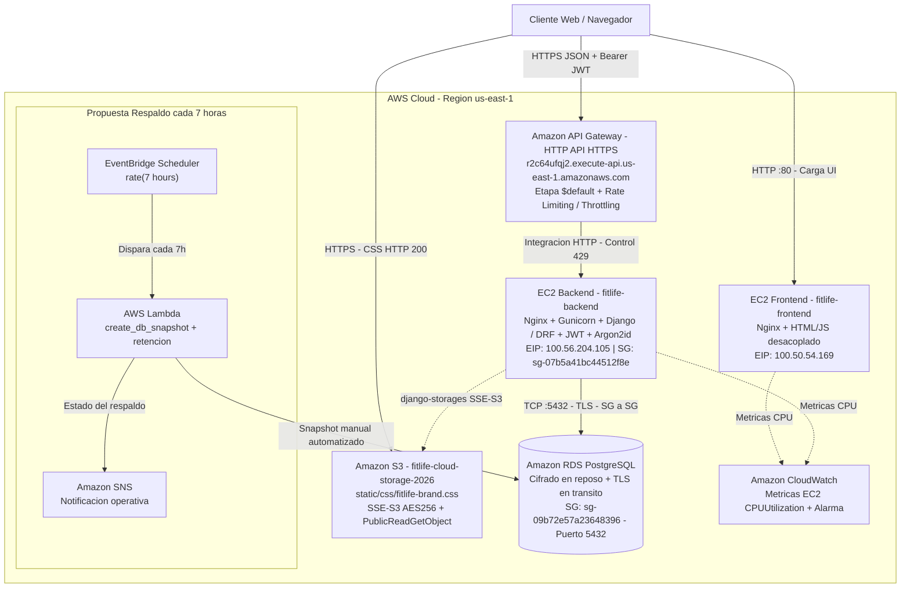
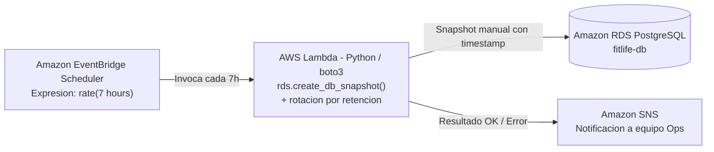

# FitLife Gym Platform – API RESTful y Arquitectura Segura en AWS

Plataforma web desacoplada para la gestión operativa de gimnasios (control de aforo en tiempo real, torniquete QR/RUT, reserva de clases grupales con lista de espera FIFO, membresías con *freeze policy* y trazabilidad de pagos), desplegada sobre una **arquitectura distribuida y segura en Amazon Web Services (AWS)** para la **Evaluación N.º 4 de Programación Backend (2026)**.

---

## 1. Ficha Técnica

| Campo | Detalle |
| :--- | :--- |
| **Proyecto** | FitLife Gym Platform – API RESTful y Arquitectura Segura en AWS |
| **Asignatura / Evaluación** | Programación Backend – Evaluación N.º 4 |
| **Estudiante** | Felipe Eduardo Rivas Garrido |
| **Sección** | AP-N4-C2 |
| **Año** | 2026 |
| **Repositorio GitHub** | https://github.com/Pipegamer/fitlife-gym (rama `main`) |
| **Región AWS** | `us-east-1` (Norte de Virginia) |
| **Frontend Desacoplado (EC2)** | `http://100.50.54.169` (`fitlife-frontend`) |
| **API Pública (API Gateway HTTPS)** | `https://r2c64ufqj2.execute-api.us-east-1.amazonaws.com` |
| **Backend API (EC2)** | `100.56.204.105` (`fitlife-backend`) |
| **Almacenamiento Estático (S3)** | `fitlife-cloud-storage-2026` (`us-east-1`) |

---

## 2. Arquitectura Lógica en AWS (`us-east-1`)

El sistema separa las responsabilidades en capas independientes para mejorar el aislamiento de red, la seguridad perimetral y la mantenibilidad:

### Diagrama de Arquitectura (Mermaid)



### Diagrama en Texto Plano

```text
[ Navegador del Usuario ]
   ├──(1) HTTP :80 ────────► [ EC2 Frontend: fitlife-frontend (100.50.54.169) ]
   │                              └── Nginx sirve frontend/index.html + frontend/config.js
   ├──(2) HTTPS :443 ──────► [ Amazon S3: fitlife-cloud-storage-2026 ]
   │                              └── static/css/fitlife-brand.css (HTTP 200, SSE-S3 AES256)
   └──(3) HTTPS JSON/JWT ──► [ Amazon API Gateway (HTTP API, etapa $default) ]
                                  ├── URL: https://r2c64ufqj2.execute-api.us-east-1.amazonaws.com
                                  ├── Throttling / Rate Limiting (HTTP 429 Too Many Requests)
                                  ▼
                             [ EC2 Backend: fitlife-backend (100.56.204.105) ]
                                  ├── SG: sg-07b5a41bc44512f8e
                                  ├── Nginx -> Gunicorn -> Django 6.1.3 + DRF 3.18.3
                                  ├── SimpleJWT (Bearer) + RBAC + Argon2id
                                  │
                                  │ (TCP 5432 + TLS, autorizado solo por SG)
                                  ▼
                             [ Amazon RDS PostgreSQL ]
                                  ├── SG: sg-09b72e57a23648396 (inbound 5432 desde sg-07b5a41bc44512f8e)
                                  ├── Cifrado en reposo habilitado desde la creacion
                                  └── Backups automaticos + Snapshot manual (+ propuesta c/7h)

[ Monitoreo ]  EC2 Frontend / Backend ──► Amazon CloudWatch (CPUUtilization + Alarma)
```

---

## 3. Stack Tecnológico y Servicios AWS Configurados

| Capa / Servicio | Tecnología / Recurso | Configuración y Rol en la Arquitectura |
| :--- | :--- | :--- |
| **EC2 Frontend** | `fitlife-frontend` (`100.50.54.169`) | Nginx sirviendo interfaz web desacoplada (`frontend/index.html` y `frontend/config.js`) que consume la API vía `fetch` con JSON y JWT. |
| **EC2 Backend** | `fitlife-backend` (`100.56.204.105`) | Nginx + Gunicorn `27.0.1` + Django `6.1.3` + Django REST Framework `3.18.3`. Security Group: `sg-07b5a41bc44512f8e`. |
| **API Gateway** | Amazon API Gateway (HTTP API) | Endpoint HTTPS `https://r2c64ufqj2.execute-api.us-east-1.amazonaws.com` en etapa `$default` con Throttling / Rate Limiting validado con respuestas `HTTP 429`. |
| **Base de Datos** | Amazon RDS PostgreSQL | Instancia dedicada separada de EC2, cifrado en reposo habilitado desde su creación, soporte TLS (`DB_SSLMODE`), driver `psycopg2-binary 2.9.13`. SG: `sg-09b72e57a23648396`. |
| **Almacenamiento** | Amazon S3 (`fitlife-cloud-storage-2026`) | Entrega de estáticos (`static/css/fitlife-brand.css`, `HTTP 200`), cifrado en reposo SSE-S3 (`AES256`), política `PublicReadGetObject` (`s3:GetObject`) e integración `boto3 1.44.9` + `django-storages 1.14.6`. |
| **Monitoreo** | Amazon CloudWatch | Recolección de métricas EC2 (`CPUUtilization`) y alarma configurada para detección temprana de saturación. |
| **Autenticación y Seguridad** | `djangorestframework_simplejwt 5.5.1`, `argon2-cffi 25.1.0`, `django-cors-headers 4.9.0`, `python-dotenv 1.2.4` | Tokens JWT Bearer con claims personalizados, hashing de contraseñas Argon2id (`argon2$argon2id$v=19`), CORS controlado por entorno y gestión segura de secretos en `.env`. |
| **Análisis de Seguridad** | SonarQube Cloud (SAST) & OWASP ZAP `2.17.0` (DAST) | Análisis estático del repositorio en `main` (`Quality Gate: Passed`) y escaneo dinámico sobre frontend y API Gateway. |

---

## 4. Endpoints Principales de la API

Definidos en `config/urls.py` y `api/urls.py`, expuestos a través de Amazon API Gateway (`https://r2c64ufqj2.execute-api.us-east-1.amazonaws.com`).

### 4.1 Autenticación JWT

| Método | Endpoint | Permisos | Descripción |
| :--- | :--- | :--- | :--- |
| `POST` | `/api/token/` | Público | Autentica usuario y retorna par `access` / `refresh` con claims personalizados (`username`, `rol`, `email`, `rut`) vía `CustomTokenObtainPairSerializer`. |
| `POST` | `/api/token/refresh/` | Público (con refresh token válido) | Emite un nuevo `access` token JWT. |

### 4.2 Operativa de Torniquete y Aforo

| Método | Endpoint | Permisos | Descripción |
| :--- | :--- | :--- | :--- |
| `POST` | `/api/acceso-qr/validar/` | Autenticado (`IsAuthenticatedOrReadOnly`) | Valida ingreso/salida por código QR o RUT normalizado, verifica vigencia y franja horaria (AM/PM), autoriza pases excepcionales (Coordinador/Admin) y realiza check-in automático a clases inminentes. |
| `GET` | `/api/aforo/metricas/` | Público (lectura) | Entrega aforo en vivo, capacidad máxima (`80`), porcentaje de ocupación, ingresos/salidas del día, socios activos, ingresos totales, últimos accesos y resumen de clases. |

### 4.3 Recursos REST (`DefaultRouter`) y Acciones de Negocio

| Recurso Base | Métodos Base | Acciones Personalizadas (`@action`) | Control de Acceso (RBAC) |
| :--- | :--- | :--- | :--- |
| `/api/usuarios/` | `GET`, `POST`, `PUT`, `PATCH`, `DELETE` | `POST /api/usuarios/crear-usuario/`<br>`POST /api/usuarios/{id}/cobrar-membresia-caja/`<br>`POST /api/usuarios/carga-masiva-csv/`<br>`POST /api/usuarios/{id}/cambiar-estado-membresia/`<br>`POST /api/usuarios/{id}/toggle-cuenta/` | Requiere `IsAuthenticated`; acciones administrativas restringidas a rol `ADMINISTRADOR`. |
| `/api/salas/` | `GET`, `POST`, `PUT`, `PATCH`, `DELETE` | — | Lectura pública (`GET`); creación y eliminación restringidas a `ADMINISTRADOR` con JWT. |
| `/api/disciplinas/` | `GET`, `POST`, `PUT`, `PATCH`, `DELETE` | — | Lectura pública (`GET`); creación y eliminación restringidas a `ADMINISTRADOR`. |
| `/api/planes/` | `GET`, `POST`, `PUT`, `PATCH`, `DELETE` | — | Lectura pública (`GET`); `POST`, `PUT`, `PATCH`, `DELETE` restringidos a `ADMINISTRADOR`. |
| `/api/membresias/` | `GET`, `POST`, `PUT`, `PATCH`, `DELETE` | `POST /api/membresias/contratar/`<br>`POST /api/membresias/congelar-socio/`<br>`POST /api/membresias/reactivar-socio/`<br>`POST /api/membresias/cancelar-socio/` | Requiere `IsAuthenticated`. Aplica *freeze policy* con recálculo automático de vigencia. |
| `/api/pagos/` | `GET`, `POST`, `PUT`, `PATCH`, `DELETE` | — | Requiere `IsAuthenticated`. Trazabilidad financiera de cobros. |
| `/api/clases/` | `GET`, `POST`, `PUT`, `PATCH`, `DELETE` | `POST /api/clases/crear-clase-admin/`<br>`POST /api/clases/{id}/coordinar/`<br>`POST /api/clases/{id}/suspender/`<br>`POST /api/clases/{id}/actualizar-rutina/`<br>`POST /api/clases/{id}/reservar/`<br>`POST /api/clases/{id}/cancelar-reserva/`<br>`POST /api/clases/{id}/cancelar-espera/`<br>`POST /api/clases/{id}/asistencia-manual/` | Lectura pública (`GET`); acciones segregadas por rol (`ADMINISTRADOR`, `COORDINADOR`, `INSTRUCTOR`, `SOCIO`). Incluye reservas atómicas (`@transaction.atomic`), lista de espera FIFO y regla de cancelación a 2 horas. |

### 4.4 Vistas Web y Reportes CSV (`config/urls.py`)

* **Vistas Django y administración:** `/admin/`, `/`, `/aforo/`, `/clases/`, `/planes/`, `/mi-membresia/`, `/instructor/`, `/dashboard/`, `/login/`, `/logout/`.
* **Exportación de reportes CSV (solo `ADMINISTRADOR`, restringidos a `GET` con `@require_GET`):**
  * `GET /reportes/socios-csv/`
  * `GET /reportes/recaudacion-csv/`
  * `GET /reportes/asistencias-csv/`
* **Fallback controlado:** Cualquier ruta no reconocida es interceptada por `error_404_view`.

---

## 5. Controles de Seguridad Implementados

### 5.1 Criptografía de Contraseñas (Argon2id)
* Configurado en `config/settings.py` mediante `PASSWORD_HASHERS` priorizando `django.contrib.auth.hashers.Argon2PasswordHasher` (respaldado por `argon2-cffi==25.1.0`), manteniendo `PBKDF2PasswordHasher` y `PBKDF2SHA1PasswordHasher` como respaldo para compatibilidad de migración.
* Las contraseñas persistidas en Amazon RDS utilizan formato **`argon2$argon2id$v=19`** con *salt* criptográfico aleatorio por usuario y resistencia a ataques por GPU/ASIC.
* Validación activa de complejidad mínima (`MinimumLengthValidator` de 8 caracteres, similitud de atributos, contraseñas comunes y puramente numéricas).

### 5.2 Autenticación JWT y Autorización RBAC
* **SimpleJWT (`Bearer`):** `ACCESS_TOKEN_LIFETIME` de 2 horas y `REFRESH_TOKEN_LIFETIME` de 1 día. El serializer `CustomTokenObtainPairSerializer` firma claims de identidad (`username`, `rol`, `email`, `rut`).
* **Política por defecto en DRF:** `IsAuthenticatedOrReadOnly`, reforzada con `IsAuthenticated` en ViewSets sensibles (`UsuarioViewSet`, `MembresiaViewSet`, `PagoViewSet`) y validaciones de rol (`ADMINISTRADOR`, `COORDINADOR`, `INSTRUCTOR`, `SOCIO`).

### 5.3 Seguridad de Base de Datos (Amazon RDS PostgreSQL)
* **Aislamiento de red (SG a SG):** El Security Group de RDS (`sg-09b72e57a23648396`) restringe el tráfico entrante del puerto `5432` exclusivamente al Security Group del servidor backend (`sg-07b5a41bc44512f8e`), bloqueando accesos directos desde Internet.
* **Cifrado en reposo y tránsito:** Cifrado en reposo habilitado desde la creación de la instancia RDS y soporte TLS configurado vía `DATABASES['default']['OPTIONS']['sslmode']` (`DB_SSLMODE`).
* **Gestión de secretos:** Todas las credenciales (`SECRET_KEY`, `DB_*`, `SEED_*_PASSWORD`) se cargan desde `.env` mediante `python-dotenv`, excluido explícitamente en `.gitignore`.

### 5.4 Seguridad de Almacenamiento (Amazon S3)
* Bucket `fitlife-cloud-storage-2026` con cifrado en reposo **SSE-S3 (`AES256`)** configurado tanto en el bucket como en `AWS_S3_OBJECT_PARAMETERS`.
* Política de bucket de solo lectura **`PublicReadGetObject`** (`s3:GetObject`) para entrega de recursos estáticos (`static/css/fitlife-brand.css`, verificado con `HTTP 200` desde `fitlife-frontend`).
* `AWS_DEFAULT_ACL = None` (Object Ownership sin ACL públicas) y `querystring_auth = True` para archivos `media` mediante URLs prefirmadas.

### 5.5 Protección Perimetral (Amazon API Gateway y Hardening Web)
* **Rate Limiting / Throttling:** Configurado en la etapa `$default` de API Gateway para mitigar ráfagas y abusos de consumo, validado empíricamente mediante respuestas **`HTTP 429 Too Many Requests`**.
* **CORS y cabeceras HTTP:** `CORS_ALLOW_ALL_ORIGINS` controlado por entorno (desactivado por defecto) junto a lista explícita `CORS_ALLOWED_ORIGINS`, `X_FRAME_OPTIONS = 'DENY'` y `SECURE_CONTENT_TYPE_NOSNIFF = True`.
* **Integridad de subrecursos (SRI):** Recurso externo versionado `bootstrap-icons@1.11.3` protegido con `integrity="sha384-..."` y `crossorigin="anonymous"` en `frontend/index.html`.

---

## 6. Resumen de Pruebas de Seguridad SAST y DAST

### 6.1 Análisis Estático (SAST – SonarQube Cloud)
* **Proyecto analizado:** `Pipegamer/fitlife-gym` (rama `main`).
* **Hallazgos detectados y remediados:**
  1. **Credenciales hardcodeadas en `seed_fitlife.py`:** Se reemplazaron contraseñas literales por lectura obligatoria de variables de entorno (`SEED_ADMIN_PASSWORD`, `SEED_COORD_PASSWORD`, `SEED_COACH_PASSWORD`, `SEED_SOCIO_PASSWORD`).
  2. **Restricción de métodos HTTP en `api/views.py`:** Se aplicaron decoradores explícitos (`@require_GET` / `@require_http_methods`) en vistas Django y exportaciones CSV.
  3. **Subresource Integrity (SRI) en `frontend/index.html`:** Se incorporó hash `SHA-384` y `crossorigin="anonymous"` a la hoja de estilos de `bootstrap-icons@1.11.3`.
* **Resultado final:** Quality Gate **`Passed`** en rama `main` con **`0` nuevos issues**.

### 6.2 Análisis Dinámico (DAST – OWASP ZAP 2.17.0)
* **Objetivos evaluados:** Frontend EC2 (`http://100.50.54.169`) y Amazon API Gateway (`https://r2c64ufqj2.execute-api.us-east-1.amazonaws.com`).
* **Reporte generado:** `2026-11-26-ZAP-Report-.html`.
* **Hallazgos críticos de inyección:** **`0` vulnerabilidades de SQL Injection (SQLi)** y **`0` vulnerabilidades de Cross-Site Scripting (XSS)**.

| Nivel de Riesgo | Cantidad | Hallazgos Principales y Tratamiento Técnico |
| :--- | :---: | :--- |
| **Alta (High)** | **1** | **Divulgación de versión `nginx/1.24.0` en cabecera `Server` (`CWE-1395`):** ZAP asocia el número de versión del banner a CVEs *upstream* de Nginx 1.24.0. Tras el análisis, se verifica que Ubuntu Server mantiene parches de seguridad *backport* en su paquete oficial sin cambiar el número de versión base, y se aplica mitigación en Nginx mediante la directiva `server_tokens off;` para suprimir la versión del banner HTTP. |
| **Media (Medium)** | **3** | 1) **Ausencia de cabecera `Content-Security-Policy` (CSP):** Recomendado definir directiva `Content-Security-Policy` en Nginx/API Gateway ajustada a S3 y orígenes permitidos.<br>2) **Subresource Integrity faltante (`CWE-345`):** Aplicado SRI SHA-384 en `bootstrap-icons@1.11.3`; en `cdn.tailwindcss.com` (Play CDN dinámico) no es viable fijar hash sin romper estilos (en producción se compila hacia S3).<br>3) **Anti-Clickjacking en servidor frontal:** Ya mitigado en Django (`X_FRAME_OPTIONS = 'DENY'`); se complementa con cabecera `X-Frame-Options: DENY` / `frame-ancestors 'none'` en Nginx del frontend. |
| **Baja (Low)** | **7** | Cabeceras complementarias de endurecimiento y divulgación menor en respuestas HTTP. |
| **Informativa (Informational)** | **3** | Observaciones de configuración y reconocimiento general sin impacto explotable directo. |

---

## 7. Monitoreo, Respaldos y Recuperación ante Desastres

### 7.1 Monitoreo en Amazon CloudWatch
* Monitoreo continuo de métricas de cómputo en instancias EC2 (`fitlife-frontend` y `fitlife-backend`), destacando **`CPUUtilization`**.
* Alarma configurada en CloudWatch para alertar ante umbrales anómalos de consumo de CPU y facilitar acciones correctivas oportunas.

### 7.2 Estrategia de Respaldos en Amazon RDS
* **Respaldos implementados:**
  * **Respaldos automáticos de RDS** habilitados (copias diarias administradas + registros de transacciones para recuperación *Point-in-Time* / PITR).
  * **Snapshot manual** verificado sobre la instancia PostgreSQL como punto de restauración controlado previo a cambios críticos.

### 7.3 Propuesta Arquitectónica de Respaldo cada 7 Horas
Amazon RDS no soporta de forma nativa programar respaldos automáticos con periodicidad de 7 horas (su ventana administrada es diaria). Para cumplir un requerimiento de RPO de 7 horas sin intervención manual, se propone la siguiente arquitectura *serverless*:



* **Disparador:** Regla en **Amazon EventBridge Scheduler** con expresión `rate(7 hours)`.
* **Ejecutor:** Función **AWS Lambda** (Python + `boto3`) con rol IAM de mínimo privilegio (`rds:CreateDBSnapshot`, `rds:DescribeDBSnapshots`, `rds:DeleteDBSnapshot`, `sns:Publish`) que crea un snapshot identificado con marca temporal (ej. `fitlife-rds-7h-YYYYMMDD-HHMM`) y purga snapshots antiguos según ventana de retención.
* **Notificación:** Publicación automática del estado (éxito o fallo) en un tópico **Amazon SNS** para trazabilidad y alerta temprana.

---

## 8. Despliegue y Configuración

### 8.1 Estructura Principal del Repositorio

```text
fitlife-gym/
├── api/                 # Modelos, serializers (SimpleJWT), ViewSets, URLs y permisos RBAC
├── config/              # settings.py (.env, Argon2id, RDS TLS, S3, CORS), urls.py, wsgi.py
├── frontend/            # Frontend desacoplado para EC2 Frontend (index.html, config.js)
├── static/css/          # fitlife-brand.css (sincronizado hacia Amazon S3)
├── templates/           # Plantillas HTML del portal backend
├── seed_fitlife.py      # Poblado inicial seguro usando variables SEED_*_PASSWORD
├── .env.example         # Plantilla de variables para seed_fitlife.py
├── .gitignore           # Excluye .env, env/, venv/, __pycache__/, staticfiles/, media/
├── requirements.txt     # Dependencias Python exactas
├── prompts_ia.md        # Bitácora de uso de IA y contraste con documentación oficial
└── README.md            # Documentación técnica y arquitectónica
```

### 8.2 Variables de Entorno (`.env` y `.env.example`)

El repositorio incluye `.env.example` con las variables requeridas por `seed_fitlife.py` y excluye `.env` en `.gitignore`. Para ejecutar el backend completo (`config/settings.py` + `seed_fitlife.py`), cree un archivo `.env` en la raíz con la siguiente estructura (reemplazando los valores de ejemplo por credenciales reales):

```env
# --- Django Core ---
SECRET_KEY=genera-una-clave-secreta-larga-y-aleatoria
DEBUG=False
ALLOWED_HOSTS=localhost,127.0.0.1,100.56.204.105,r2c64ufqj2.execute-api.us-east-1.amazonaws.com

# --- Base de Datos (PostgreSQL local o Amazon RDS) ---
DB_NAME=fitlife_db
DB_USER=fitlife_user
DB_PASSWORD=cambia-esta-clave-rds
DB_HOST=tu-endpoint.rds.us-east-1.amazonaws.com
DB_PORT=5432
DB_SSLMODE=require

# --- Amazon S3 (Estáticos y Media) ---
USE_S3=True
AWS_STORAGE_BUCKET_NAME=fitlife-cloud-storage-2026
AWS_S3_REGION_NAME=us-east-1

# --- CORS ---
CORS_ALLOW_ALL_ORIGINS=False
CORS_ALLOWED_ORIGINS=http://100.50.54.169,https://r2c64ufqj2.execute-api.us-east-1.amazonaws.com

# --- Contraseñas para seed_fitlife.py (definidas en .env.example) ---
SEED_ADMIN_PASSWORD=cambia-esta-clave
SEED_COORD_PASSWORD=cambia-esta-clave
SEED_COACH_PASSWORD=cambia-esta-clave
SEED_SOCIO_PASSWORD=cambia-esta-clave
```

> **Nota de seguridad:** Nunca versione el archivo `.env` ni incluya contraseñas literales en el código fuente. En EC2 Backend se recomienda otorgar permisos a S3 mediante IAM Role de instancia o variables de entorno protegidas.

### 8.3 Instalación y Ejecución Local

```bash
# 1. Clonar el repositorio (rama main)
git clone https://github.com/Pipegamer/fitlife-gym.git
cd fitlife-gym

# 2. Crear y activar entorno virtual
python -m venv env
# Linux / macOS:
source env/bin/activate
# Windows (PowerShell):
.\env\Scripts\Activate.ps1

# 3. Instalar dependencias
pip install -r requirements.txt

# 4. Configurar .env a partir de .env.example (completando variables de Django/DB)
cp .env.example .env

# 5. Ejecutar migraciones, verificar integridad y poblar datos iniciales
python manage.py check
python manage.py migrate
python seed_fitlife.py

# 6. Iniciar servidor de desarrollo
python manage.py runserver
```

### 8.4 Despliegue en AWS (Backend y Frontend Desacoplado)

1. **EC2 Backend (`fitlife-backend` – `100.56.204.105`):**
   * Configurar `.env` apuntando al endpoint de Amazon RDS PostgreSQL (`DB_SSLMODE=require`) y al bucket `fitlife-cloud-storage-2026` (`USE_S3=True`).
   * Ejecutar `python manage.py migrate` y `python manage.py collectstatic --noinput` para publicar estáticos con cifrado SSE-S3.
   * Servir la aplicación WSGI con **Gunicorn** detrás de **Nginx** (incluyendo `server_tokens off;` en el bloque `http` de Nginx) y gestionar el proceso vía `systemd`:
     ```bash
     gunicorn --workers 3 --bind 127.0.0.1:8000 config.wsgi:application
     sudo systemctl restart fitlife
     sudo systemctl reload nginx
     ```
2. **Amazon API Gateway (HTTP API):**
   * Integrar las rutas de la API hacia el backend (`fitlife-backend`) bajo la etapa `$default` con HTTPS y reglas de Rate Limiting / Throttling activas.
3. **EC2 Frontend (`fitlife-frontend` – `100.50.54.169`):**
   * Desplegar `frontend/index.html` y `frontend/config.js` en la raíz web de Nginx (`/var/www/html` o virtual host dedicado), manteniendo `API_BASE_URL` apuntando a `https://r2c64ufqj2.execute-api.us-east-1.amazonaws.com` y `S3_STATIC_CSS_URL` apuntando a `https://fitlife-cloud-storage-2026.s3.us-east-1.amazonaws.com/static/css/fitlife-brand.css`.
   * Verificar carga de CSS desde S3 (`HTTP 200`), autenticación JWT (`POST /api/token/`) y operaciones CRUD persistidas en Amazon RDS.

---

## 9. Licencia y Créditos

Proyecto académico desarrollado por **Felipe Eduardo Rivas Garrido** (Sección **AP-N4-C2**, **2026**) para la asignatura de **Programación Backend – Evaluación N.º 4**.
